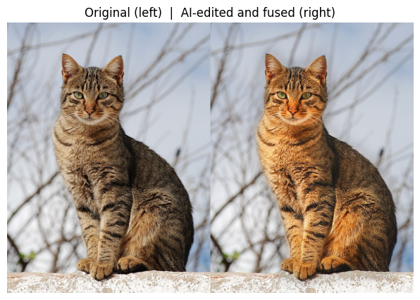

# Performance Analysis of CPU and GPU Architectures for Image Editing: Color Grading, Masking, and Fusion

A comparative study of how CPU and GPU architectures perform on three common image-editing operations: **color grading**, **masking**, and **image fusion**. Each operation is implemented for both architectures and benchmarked on the same inputs, so the speed-up (or lack of one) can be measured and explained.

## Key findings

- **AI masking benefits most:** Mask R-CNN detection ran in 159 ms on the GPU versus 4,982 ms on the CPU, about **31x faster**.
- **The full edit pipeline is 4x to 8x faster on the GPU.** The speed-up grows with image size, from 4.2x at 0.25 MP to 8.0x at 8 MP.
- **A simple color grade barely benefits.** On its own, the GPU was slower at 0.25 MP (0.86x) and only reached 1.6x at 8 MP, because the cost of moving data to and from the GPU is comparable to the tiny amount of computation.
- **Transfers dominate GPU time.** At 8 MP the GPU kernels took only 34 ms, but the end-to-end GPU time was 322 ms. Uploading, downloading and the fusion step account for the rest.
- **No loss of quality.** CPU and GPU outputs match (PSNR above 140 dB, SSIM 1.0 at the sizes where it was computed).

## Overview

Image-editing workloads are highly parallel, since the same operation is applied to millions of pixels, which makes them a natural fit for GPUs. In practice, the benefit depends on the operation, the image size, and the cost of moving data between host and device. This project measures that trade-off across three operations.

## Operations studied

| Operation | What was implemented | CPU | GPU |
|---|---|---|---|
| **Color grading** | A 3x3 color matrix (the "raw" workload), and a Lightroom-style edit with exposure, white balance, highlights and shadows, contrast, saturation and vignette | NumPy | Numba CUDA kernels |
| **Masking** | AI subject mask from Mask R-CNN (ResNet-50 FPN) with a feathered edge, so the subject and background are edited with separate settings. Edit parameters are derived automatically from the brightness of each region | PyTorch on CPU | PyTorch on GPU |
| **Fusion** | Subject sharpening, then multi-level (5-level) Laplacian pyramid blending of the edited and original images using the mask | OpenCV | PyTorch on GPU |

## Experimental setup

- **Hardware:** Google Colab with an NVIDIA T4 GPU
- **Software:** Python, NumPy, Numba (CUDA), PyTorch and torchvision, OpenCV
- **Workloads:** *Raw* (color matrix only) and *Edited* (AI mask, edit, sharpen and pyramid fusion)
- **Image sizes:** 0.25, 1, 4 and 8 megapixels, resized from the source photo (`images.jpg`)
- **Timing:** one warm-up run, then the median of repeated runs, with GPU synchronization before stopping the clock. GPU timings include upload and download of the data, and the notebook also reports kernel-only time.
- **Correctness:** CPU and GPU outputs are compared with PSNR, SSIM and maximum absolute error.

## Results

| Size | Raw CPU | Raw GPU | Raw speed-up | Edited CPU | Edited GPU | Edited speed-up | GPU kernels only |
|---|---|---|---|---|---|---|---|
| 0.25 MP | 2.0 ms | 2.3 ms | 0.86x | 43.7 ms | 10.4 ms | 4.2x | 2.7 ms |
| 1 MP | 8.8 ms | 6.5 ms | 1.35x | 204.9 ms | 33.0 ms | 6.2x | 10.3 ms |
| 4 MP | 47.2 ms | 32.7 ms | 1.44x | 1,248.3 ms | 196.4 ms | 6.4x | 25.2 ms |
| 8 MP | 93.2 ms | 59.1 ms | 1.58x | 2,570.3 ms | 322.0 ms | 8.0x | 34.2 ms |

The raw numbers are in [`results.csv`](results.csv).

## Conclusion

The GPU is a clear win for heavy, multi-stage pipelines such as AI masking plus editing plus fusion, and the advantage grows with image size. For a single lightweight per-pixel operation, the transfer overhead cancels most of the benefit and the GPU can even lose on small images. The practical lesson is to keep data on the GPU across as many stages as possible instead of sending it back and forth for each step.

## Run the code

Open the notebook directly in Google Colab (set the runtime to GPU):

Or view the notebook on GitHub: [CAO_Project.ipynb](CAO_Project.ipynb)

**Input image:** the notebook loads [`images.jpg`](https://github.com/blessszzz/Image-Editing/blob/main/images.jpg) from the repo root (tap the link to open it). In Colab, upload it through the folder icon in the left sidebar before running, or add a cell at the top with `!wget -q https://raw.githubusercontent.com/blessszzz/Image-Editing/main/images.jpg`. To test your own photo, replace it with another image of the same name. The AI masking step looks for a cat (COCO class 17), so use a photo with a cat in it, or change the class ID in the notebook.

## Repository contents

| File | Description |
|---|---|
| `CAO_Project.ipynb` | Full notebook: implementations, benchmarks and plots |
| `images.jpg` | Input photo used for all tests |
| `results.csv` | Raw benchmark numbers from the notebook run |
| `results/` | Before/after image used in this README |
